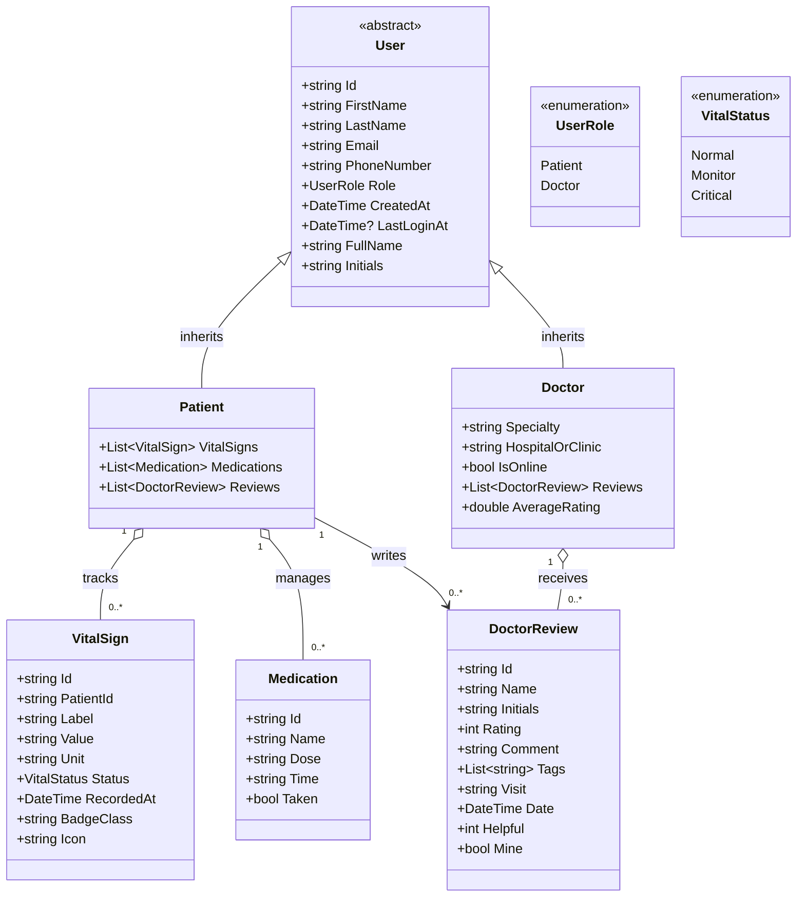

# DocTient — Connected Healthcare Management Platform

[](https://dotnet.microsoft.com/)
[](https://dotnet.microsoft.com/apps/aspnet/web-apps/blazor)
[](https://tailwindcss.com/)
[](#license)

> **DocTient** is a client-side Blazor WebAssembly healthcare application that bridges the communication and data-monitoring gap between patients and medical professionals. Designed to operate seamlessly between in-person consultations, DocTient enables continuous vital sign monitoring, medication adherence tracking, and doctor-patient feedback under an accessible, dark-glassmorphism user interface.

---

## Table of Contents

- [The Healthcare Problem & Importance](#the-healthcare-problem--importance)
  - [The Post-Consultation Gap](#the-post-consultation-gap)
  - [Why Continuous Oversight Matters](#why-continuous-oversight-matters)
- [Core Functionalities & How Features Work](#core-functionalities--how-features-work)
  - [1. Real-Time Vitals Tracking & Assessment](#1-real-time-vitals-tracking--assessment)
  - [2. Longitudinal Trend Visualization (7-Day Heart Rate)](#2-longitudinal-trend-visualization-7-day-heart-rate)
  - [3. Medication Reminders & Adherence System](#3-medication-reminders--adherence-system)
  - [4. Consultation Rating & Doctor Feedback Mechanism](#4-consultation-rating--doctor-feedback-mechanism)
  - [5. Dual Role-Based Access Control](#5-dual-role-based-access-control)
  - [6. Therapeutic Glassmorphism Design System](#6-therapeutic-glassmorphism-design-system)
- [How DocTient Works in Practice (User Workflows)](#how-doctient-works-in-practice-user-workflows)
  - [Patient Daily Care Routine](#patient-daily-care-routine)
  - [Doctor Oversight & Consultation Loop](#doctor-oversight--consultation-loop)
- [System Architecture & Class Diagram](#system-architecture--class-diagram)
- [Initial Domain Models](#initial-domain-models)
- [Project Structure](#project-structure)
- [Getting Started](#getting-started)
- [Authors & Attribution](#authors--attribution)

---

## The Healthcare Problem & Importance

### The Post-Consultation Gap

In traditional outpatient healthcare, the patient's journey is heavily transactional. A patient sees a doctor, receives recommendations or prescriptions, and leaves the clinic. From that moment until the follow-up appointment—often weeks or months later—the healthcare provider is completely blind to the patient's day-to-day physiological condition.

This disconnect leads to several critical healthcare risks:
1. **Isolated Snapshot Data:** In-clinic vitals are often skewed by temporary anxiety (e.g. *white-coat hypertension*) and fail to reflect true baseline health.
2. **Silent Degradation:** Progressive complications in chronic illnesses (hypertension, cardiovascular disease, respiratory issues) develop quietly between check-ups without triggering immediate alarms.
3. **Medication Non-Adherence:** Forgetting dosages or timing errors is one of the leading causes of preventable emergency hospitalizations worldwide.
4. **Lack of Patient Feedback:** Patients have few structured channels to communicate how well a consultation or treatment plan met their needs.

### Why Continuous Oversight Matters

DocTient transforms patient care from **episodic visits** into **continuous, proactive oversight**:
- **Empowered Self-Management:** Patients take ownership of their health by reviewing everyday readings and receiving immediate contextual feedback.
- **Evidence-Based Doctor Consultations:** Rather than relying on fuzzy patient memory during check-ups, doctors can review objective daily data.
- **Preventative Intervention:** By flagging abnormal parameters (e.g., elevated blood pressure or dropping oxygen levels), conditions can be managed before requiring hospitalization.

---

## Core Functionalities & How Features Work

### 1. Real-Time Vitals Tracking & Assessment

#### What It Does
Provides an immediate, high-visibility dashboard tracking five fundamental physiological biomarkers:
- **Blood Pressure (BP):** Measured in mmHg (Systolic / Diastolic).
- **Heart Rate (Pulse):** Measured in beats per minute (bpm).
- **Body Temperature:** Measured in degrees Celsius (°C).
- **Blood Oxygen Saturation (SpO2):** Measured as a percentage (%).
- **Body Weight:** Measured in kilograms (kg).

#### How It Works
1. Each biomarker is displayed on an individual glassmorphism card accompanied by a clinical unit and visual indicator.
2. The system compares readings against standard clinical baselines:
   - Readings within safe parameters receive a green `Normal` status badge.
   - Borderline or elevated readings automatically transition to an amber `Monitor` or red `Critical` badge.
3. Displays an explicit timestamp (`Last logged: 7:30 AM today`) so patients and doctors always know the recency of the data.

#### Clinical Importance
Enables early detection of hypertensive episodes, fever onset, hypoxia in respiratory conditions, or sudden weight fluctuation.

---

### 2. Longitudinal Trend Visualization (7-Day Heart Rate)

#### What It Does
Translates raw numerical pulse logs into an intuitive, vector-rendered SVG trend line spanning the last seven days, alongside an automatically calculated average (e.g. `Avg 74 bpm`).

#### How It Works
1. An inline SVG chart plots coordinates representing daily heart rate measurements from Monday through Sunday.
2. The area beneath the line is shaded with a sky-blue linear gradient fill (`#38bdf8`), rendering peaks and valleys easily scannable at a glance.
3. Subtle horizontal reference gridlines provide scale context without visual clutter.

#### Clinical Importance
A single heart rate reading tells very little. A 7-day trend allows doctors to instantly detect resting bradycardia, sustained tachycardia, stress patterns, or treatment efficacy without digging through spreadsheets of raw numbers.

---

### 3. Medication Reminders & Adherence System

#### What It Does
Maintains an active digital checklist detailing current prescribed medications, their exact dosages, and intended administration times.

#### How It Works
1. Each medication (e.g., *Amlodipine 5 mg at 8:00 AM*, *Metformin 500 mg at 12:00 PM*) is presented with its status.
2. **Untaken items** display a prominent, clickable `Mark taken` trigger.
3. Clicking the button updates the medication entity in real time:
   - The card border illuminates with a soft emerald glow (`border-emerald-500/20`).
   - The trigger morphs into a checkmark badge (`✓ Taken`).
   - The medication icon shifts from muted white to emerald green.

#### Clinical Importance
Eliminates double-dosing accidents and missed regimens. Patients can glance at their dashboard at any point during the day and know exactly what has and has not been taken.

---

### 4. Consultation Rating & Doctor Feedback Mechanism

#### What It Does
An interactive review system located at `/feedback` where patients can submit structured, constructive feedback on their recent medical visits.

#### How It Works
1. **Visit Association:** The patient selects the specific consultation date and reason from a dropdown linked to their visit history (e.g., `Sep 17 · Follow-up — BP 118/76, HR 72 bpm`).
2. **Interactive Star Rating:** Supports interactive 1 to 5 star ratings with dynamic hover previews and qualitative labels (`Poor`, `Fair`, `Good`, `Very Good`, `Excellent`).
3. **Standout Experience Tags:** Quick-select tags allow patients to highlight specific clinical strengths (*Friendly*, *On-time*, *Clear explanation*, *Listens well*, *Caring follow-up*, *Clean clinic*).
4. **Validated Comment Box:** Patients provide contextual feedback within a character-counted input (up to 500 characters).
5. **Dynamic Summary & Distribution:** Submitted reviews instantly update the doctor's average rating calculation and the visual star distribution bar chart.
6. **Community Helpful Counter:** Patients can upvote helpful reviews and manage their own posted feedback.

#### Clinical Importance
Encourages transparent patient-provider accountability. Positive feedback reinforces good clinical practices, while constructive feedback highlights communication gaps or scheduling bottlenecks in clinic workflows.

---

### 5. Dual Role-Based Access Control

#### What It Does
Provides distinct, tailored experiences for both **Patients** and **Healthcare Providers** accessible via dedicated authentication tabs on the Login (`/login`) and Sign-Up (`/signup`) pages.

#### How It Works
- **Patient Registration:** Requires core contact and identity details. Directs users immediately to their personal vitals tracking and medication dashboard.
- **Doctor Registration:** Expands registration to require professional clinical criteria, including specialty selection (e.g., *General Practitioner*, *Cardiologist*, *Internist*, *Pulmonologist*, *Endocrinologist*).

#### Clinical Importance
Enforces separation of concerns. Doctors and patients have fundamentally different responsibilities in healthcare delivery, and distinct entry flows establish correct access rights and workflows.

---

### 6. Therapeutic Glassmorphism Design System

#### What It Does
Employs an intentionally designed dark navy aesthetic featuring frosted glass panels, subtle glowing gradients, and fluid micro-animations.

#### How It Works
- **Visual Depth:** Uses backdrop blurring (`backdrop-blur-xl`), semi-transparent surfaces (`bg-white/10`), and delicate luminous borders (`border-white/20`).
- **Micro-Interactions:** Custom CSS animations (`anim-fade-up`, `anim-fade-left`, `anim-float`) stagger the arrival of data cards upon page load.
- **Card-Lift Hover Effects:** Interactive elements gently elevate (`translateY(-3px)`) when hovered, providing tactile feedback.

#### Clinical Importance
Medical dashboards can often feel sterile, intimidating, and stressful. The calming dark palette and gentle visual hierarchy reduce cognitive overload and medical anxiety for patients checking their vitals daily.

---

## How DocTient Works in Practice (User Workflows)

### Patient Daily Care Routine

```
[Start Day]
    │
    ▼
[Open Dashboard (/dashboard)]
    │
    ├─► Check Medication Reminders ──► Take prescribed dose ──► Click "Mark as taken"
    │
    ├─► Log Daily Vitals ────────────► Review immediate status badge (Normal/Monitor)
    │
    ├─► Inspect 7-Day Heart Rate ───► Verify average pulse stability
    │
    ▼
[Follow-Up Visit Occurred]
    │
    ▼
[Navigate to /feedback]
    │
    ├─► Select completed visit
    ├─► Rate consultation (1-5 Stars)
    ├─► Choose standout tags & write review
    └─► Post feedback to help doctor & peers
```

### Doctor Oversight & Consultation Loop

```
[Doctor Access]
    │
    ▼
[Review Connected Patient Profile]
    │
    ├─► Examine longitudinal vitals history (BP, HR, SpO2 trends)
    ├─► Check medication adherence confirmations
    │
    ▼
[Conduct Consultation]
    │
    ├─► Formulate informed clinical diagnosis using historical data
    ├─► Adjust medications or schedule follow-up
    │
    ▼
[Receive Post-Visit Review]
    │
    └─► Review patient feedback and quality tags to improve care delivery
```

---

## System Architecture & Class Diagram

The application's initial domain models directly represent the entities actively displayed and managed across the implemented screens:



---

## Initial Domain Models

The models are located in [`DocTient/Models`](Models/) and strictly correspond to the currently implemented screens:

| Model | Applicable Screens | Primary Responsibility |
|---|---|---|
| `User` | [`Login.razor`](Pages/Login.razor), [`Signup.razor`](Pages/Signup.razor) | Abstract identity base class holding authentication and profile attributes. |
| `Patient` | [`Signup.razor`](Pages/Signup.razor), [`Dashboard.razor`](Pages/Dashboard.razor) | Patient account entity holding lists of vitals, medications, and reviews. |
| `Doctor` | [`Signup.razor`](Pages/Signup.razor), [`Dashboard.razor`](Pages/Dashboard.razor), [`Feedback.razor`](Pages/Feedback.razor) | Doctor profile entity with specialty, clinic affiliation, online status, and average rating. |
| `VitalSign` | [`Dashboard.razor`](Pages/Dashboard.razor) | Vitals metrics (Blood Pressure, Heart Rate, Temperature, Oxygen, Weight) with status badge styling. |
| `Medication` | [`Dashboard.razor`](Pages/Dashboard.razor) | Daily prescription checklist items tracking dosage, time, and adherence toggle. |
| `DoctorReview` | [`Feedback.razor`](Pages/Feedback.razor) | 1–5 star patient feedback, standout experience tags, and visit linkage. |
| `Enums` | All pages | `UserRole` (`Patient`, `Doctor`) and `VitalStatus` (`Normal`, `Monitor`, `Critical`). |

---

## Project Structure

```text
DocTient/
├── Layout/
│   └── MainLayout.razor        # Base layout component
├── Models/                     # Core domain models
│   ├── Doctor.cs
│   ├── DoctorReview.cs
│   ├── Enums.cs
│   ├── Medication.cs
│   ├── Patient.cs
│   ├── User.cs
│   └── VitalSign.cs
├── Pages/                      # Currently implemented routed components
│   ├── Dashboard.razor         # Patient health metrics & medications
│   ├── Feedback.razor          # Doctor rating and review submission
│   ├── Home.razor              # Public landing page and hero section
│   ├── Login.razor             # Role-selected authentication
│   └── Signup.razor            # User & practitioner registration
├── Properties/
│   └── launchSettings.json     # Local development server ports
├── wwwroot/
│   ├── css/
│   │   └── app.css             # Glassmorphism tokens, gradients & keyframe animations
│   ├── icon-192.png            # Application icon
│   └── index.html              # Single Page Application HTML shell
├── App.razor                   # Client-side router configuration
├── DocTient.csproj             # .NET 8 Blazor WASM project configuration
├── DocTient.sln                # Solution file
├── Program.cs                  # WebAssembly host builder
├── README.md                   # Complete documentation
└── _Imports.razor              # Global namespace imports
```

---

## Getting Started

### Prerequisites

- [.NET 8.0 SDK](https://dotnet.microsoft.com/download/dotnet/8.0)
- Modern web browser with WebAssembly support (Chrome, Edge, Safari, Firefox)

### Running Locally

1. **Clone the repository:**
   ```bash
   git clone https://github.com/Ycany-Sanchez/CSIT321-DocTient.git
   cd CSIT321-DocTient
   ```

2. **Restore dependencies:**
   ```bash
   dotnet restore
   ```

3. **Build the project:**
   ```bash
   dotnet build
   ```

4. **Launch the application:**
   ```bash
   dotnet run
   ```
   Or launch with hot-reload enabled:
   ```bash
   dotnet watch
   ```

5. **Access the application:**
   Open your browser and navigate to the local HTTPS port output in your terminal (usually `https://localhost:5001` or `http://localhost:5000`).

---

## Authors & Attribution

- **Author:** [Ycany-Sanchez](https://github.com/Ycany-Sanchez)
- **Course:** CSIT321 — Applications Development and Emerging Technologies
- **Peer Reviewers:** Quibuyen, Renzo Pogoy
